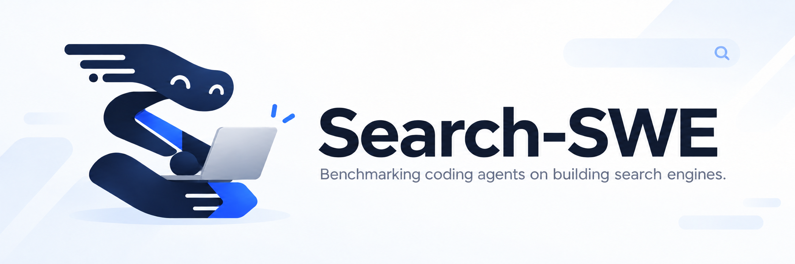

<p align="center">
  
</p>

<h1 align="center">
  Search-SWE
  <br>
  <sub>🔍 Benchmarking coding agents on building search engines. 🤖</sub>
</h1>

<p align="center">
  <a href="https://search-swe.github.io/"></a>
  <a href="https://search-swe.github.io/tasks.html"></a>
  <a href="https://huggingface.co/datasets/search-swe/Search-SWE"></a>
  <a href="LICENSE"></a>
</p>

<p align="center">
  <b>English</b> · <a href="README_zh.md">简体中文</a>
</p>

> *Note: Search-SWE is an ongoing project; tasks, documentation, and results
> are still evolving.*

## 📖 Overview

Search-SWE evaluates whether coding agents can **implement and optimize** real
search systems under fixed resource constraints. Tasks span query understanding,
indexing, retrieval, ranking, and representation learning, with applications
ranging from document and code search to multimodal retrieval.

Agents work with fixed inputs in reproducible environments, write and test code,
and iterate on executable systems. A separate verifier evaluates functionality,
retrieval quality, efficiency, and compliance with task rules on held-out queries.
Each task defines a submission interface and resource budget, making practical
trade-offs between search quality, latency, and resource use part of the work.

See the [benchmark design](docs/benchmark.md) for evaluation details and data provenance.

## 🚀 Quick Start

Use a native Linux x86_64 host with **Python 3.12+, Git, and Docker**, plus the
CPU/RAM and optional GPU resources required by your chosen tasks.

### Run with the CLI

Use CLI **0.2.x** with a checkout from the same release series.

```bash
pip install search-swe
search-swe run
```

Follow the prompts to choose a repository location, harness/provider/model,
API keys, tasks, and sequential or parallel execution. The default setting is
**Codex + OpenRouter + GPT-6 Luna (max)**. The CLI downloads the selected tasks'
assets as needed and saves logs and results under `jobs/evaluations/` in the checkout.
Before downloading, it shows the task/cache locations and required disk space;
see the [asset guide](docs/evaluation/assets.md) to choose a cache on another disk.

Submission API keys require fixed [OpenRouter model allowlists](docs/evaluation/submission-models.md):
**47 models** for the shared key and **17** for `reasoning-query-rewriting`.
The CLI checks enabled keys before a run and stops if restrictions fail validation.
Coding-agent and judge keys use separate model access.

### Run through your agent

Install [run-searchswe-evaluation](skills/run-searchswe-evaluation/SKILL.md) into
your coding agent using either installer (Codex shown here):

```bash
npx skills add VectorSpaceLab/Search-SWE --skill run-searchswe-evaluation -a codex

# Or, with GitHub CLI:
gh skill install VectorSpaceLab/Search-SWE skills/run-searchswe-evaluation --agent codex
```

Then ask your agent:

> Use run-searchswe-evaluation to run agentic-search with Codex + OpenRouter +
> openai/gpt-6-luna and max reasoning. Help me configure missing keys locally,
> monitor the run, and report the results.

See [CLI options](docs/evaluation/cli.md), [agent setup](docs/evaluation/quickstart.md#run-with-your-agent), and
[host and credential configuration](docs/evaluation/runtime.md) for details.

## 📚 Documentation

Start at the [documentation index](docs/README.md). Common reading paths:

- **Run your first evaluation:** [quick start](docs/evaluation/quickstart.md), with CLI and agent workflows.
- **Choose a setting:** [supported agents and providers](docs/evaluation/agents.md).
- **Configure the host:** [credentials, GPU and native launcher](docs/evaluation/runtime.md).
- **Contribute a task:** [authoring, model feedback and review](docs/contributing/tasks.md).

For task descriptions and results, visit the
[project website](https://search-swe.github.io/), maintained in a
[separate repository](https://github.com/search-swe/search-swe.github.io).

## 🤝 Contributing

Contributions are welcome. For new or substantially revised tasks, start with
the workflow and skills in [`.agents/`](.agents/AGENTS.md), including
[`create-searchswe-task`](.agents/skills/create-searchswe-task/SKILL.md) for task authoring
and [`maintain-searchswe-task`](.agents/skills/maintain-searchswe-task/SKILL.md) for
PR review and publication. See the
[contribution entry](CONTRIBUTING.md) and [guide](docs/contributing/tasks.md) for validation and PR requirements.

Task authoring includes running a configured coding model, inspecting its
trajectory and evaluation results, and using that feedback to refine the task
setting. Revalidate any changes that affect the task or scoring and report the
final tested revision. If required API keys are missing, the authoring agent
asks the contributor to configure them locally before the trial.

Create tasks directly at `tasks/<task-name>` in your contribution branch. Choose
a descriptive name of at most five lowercase, hyphen-separated words, and use
it for the package and its official data. One PR may add multiple tasks. Review
and validate each package, then merge with a merge commit to preserve original
authors.

Public upstream HF datasets may be used directly with immutable commit pins,
exact filenames, sizes and SHA-256 hashes. Verify downloads, provenance and usage
terms before merging; official re-upload is optional. When official publication
is needed, publish under `tasks/<task-name>/` and pin the merged HF SHA first.
Use `--task <task-name>` for downloads and local trials.

## Citation

TBA
