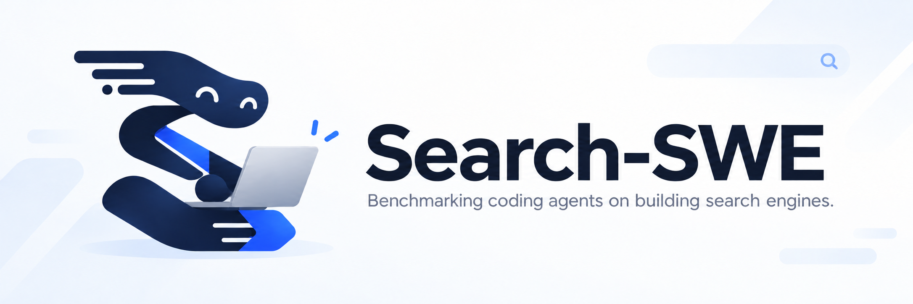

<p align="center">
  
</p>

<h1 align="center">
  Search-SWE
  <br>
  <sub>🔍 评测编码智能体构建搜索引擎的能力。 🤖</sub>
</h1>

<p align="center">
  <a href="https://search-swe.github.io/"></a>
  <a href="https://search-swe.github.io/tasks.html"></a>
  <a href="https://huggingface.co/datasets/search-swe/Search-SWE"></a>
  <a href="LICENSE"></a>
</p>

<p align="center">
  <a href="README.md">English</a> · <b>简体中文</b>
</p>

> *Note: Search-SWE 是一个持续演进的项目，任务、文档和评测结果仍在不断更新。*

## 📖 概述

Search-SWE 评估编码智能体能否在固定资源约束下**实现和优化**真实的搜索系统。
任务涵盖查询理解、索引、检索、排序和表示学习，应用场景包括文档搜索、代码搜索
和多模态检索。

智能体在可复现的环境中使用固定输入，编写和测试代码，迭代出可执行的系统。
独立的 verifier 使用隐藏查询评估功能、检索质量、效率及任务规则的遵守情况。
每个任务都明确提交接口和资源预算，使搜索质量、延迟和资源消耗之间的权衡成为
解题过程的一部分。

评测细节与数据来源见[基准设计](docs/benchmark.md)。

## 🚀 快速开始

使用安装了 **Python 3.12+、Git 和 Docker** 的原生 Linux x86_64 主机，并为所选任务
准备所需的 CPU、内存，以及 GPU（如需）。

### 通过 CLI 运行

使用 **0.2.x** 版本的 CLI 和同一版本系列的 checkout。

```bash
python -m pip install --upgrade 'search-swe>=0.2,<0.3'
search-swe run
```

按提示选择仓库路径、harness/provider/model、API key、任务及顺序或并行运行方式。
默认 setting 为 **Codex + OpenRouter + GPT-6 Luna（max）**。CLI 会按需下载所选任务
的数据和模型，并将日志与结果保存在 checkout 下的 `jobs/evaluations/`。
下载前会展示任务数据、缓存的位置及所需磁盘空间；将缓存放到其他磁盘的方法见[资源说明](docs/evaluation/assets.md)。

Submission API key **必须配置**固定的 [OpenRouter 模型白名单](docs/evaluation/submission-models.md)：
共享 key 为 **47 个模型**，`reasoning-query-rewriting` 专用 key 为 **17 个模型**。
CLI 会在运行前检查已启用的 key，限制未通过验证时停止运行。
Coding agent 和 judge 的 key 使用各自独立的模型权限。

### 通过自己的 agent 运行

将 [run-searchswe-evaluation](skills/run-searchswe-evaluation/SKILL.md) 安装到
自己的 coding agent，任选一种安装方式（以下以 Codex 为例）：

```bash
npx skills add VectorSpaceLab/Search-SWE --skill run-searchswe-evaluation -a codex

# 或使用 GitHub CLI：
gh skill install VectorSpaceLab/Search-SWE skills/run-searchswe-evaluation --agent codex
```

然后告诉 agent：

> 使用 run-searchswe-evaluation，以 Codex + OpenRouter + openai/gpt-6-luna、
> max 推理强度运行 agentic-search。协助我在本地配置缺少的 key，跟踪运行并汇报结果。

详细说明见 [CLI 参数](docs/evaluation/cli.md)、[agent 配置](docs/evaluation/quickstart.md#run-with-your-agent)及
[主机与凭证配置](docs/evaluation/runtime.md)。

## 📚 文档索引

从[文档首页](docs/README.md)选择阅读路径：

- **首次运行评测：**[快速开始](docs/evaluation/quickstart.md)，包含 CLI 与 agent 两种方式。
- **选择评测 setting：**[支持的智能体与 provider](docs/evaluation/agents.md)。
- **配置运行主机：**[凭证、GPU 与原生启动器](docs/evaluation/runtime.md)。
- **贡献任务：**[任务构建、模型反馈与审查](docs/contributing/tasks.md)。

任务介绍和评测结果可在[项目主页](https://search-swe.github.io/)查看，主页由
[独立仓库](https://github.com/search-swe/search-swe.github.io)维护。

## 🤝 参与贡献

欢迎参与贡献。创建新任务或大幅修改已有任务时，请先使用 [`.agents/`](.agents/AGENTS.md)
中的工作流和 skills，包括
[`create-searchswe-task`](.agents/skills/create-searchswe-task/SKILL.md)（任务投稿）和
[`maintain-searchswe-task`](.agents/skills/maintain-searchswe-task/SKILL.md)（PR 审查与发布）。验证要求和
PR 说明见[贡献入口](CONTRIBUTING.md)与[贡献指南](docs/contributing/tasks.md)。

任务构建还包括使用配置好的编码模型试跑，检查执行轨迹和评测结果，并根据反馈
完善任务设定。影响任务要求或评分的修改需要重新验证，并记录最终测试的版本。
如果缺少必需的 API key，负责构建任务的智能体应在试跑前提醒贡献者在本地配置。

在贡献分支中直接将新任务放在 `tasks/<task-name>`。名称使用不超过五个词的
小写连字符短语，任务包与官方数据使用同一名称。一个 PR 可以包含多个任务；
逐一完成审查与验证后，使用 merge commit 保留原作者历史。

可以直接使用上游公开 HF 数据集，固定完整 commit SHA、文件路径、大小和 SHA-256。
合并前验证下载、来源和使用条件，无须强制重新上传到官方仓库。需要官方发布时，
将输入放在 `tasks/<task-name>/` 下，并先固定官方已合并的 HF SHA。
使用 `--task <task-name>` 下载数据和进行本地试跑。

## 引用

TBA
